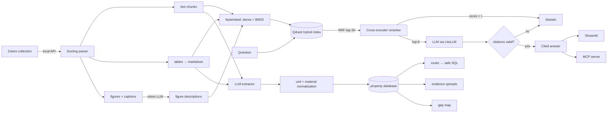

# 🔋 MgScholar — a research copilot for magnesium-battery literature

MgScholar turns your Zotero library of Mg-battery papers into three tools:

- **Ask** — answers with page-level citations to text, tables and figures, or an honest *"not in your library"*.
- **Compare** — the literature as a database: rank capacities or efficiencies across papers in normalized units,
  and see **where papers disagree**, with both sources side by side and an explanation of why.
- **Discover** — a coverage map of what your library has measured, and suggested **research gaps** grounded in it.

Every design choice is measured, not assumed.

> Built by an electrochemistry postdoc. The evaluation set was written by a domain expert,
> which is the part generic RAG demos cannot copy.

<!-- Replace with your demo GIF (record with ScreenToGif / Kap / OBS) -->


## What makes it different

| | Typical RAG tutorial | MgScholar |
|---|---|---|
| Parsing | `PyPDF` text only | **Docling** layout model: reading order, sections, **tables as real rows/columns**, figures + captions |
| Figures | ignored | **Vision-LLM figure descriptions** so plots become searchable |
| Retrieval | one vector search | **Hybrid** dense + BM25 (exact chemistry tokens like `Mg(TFSI)2`) fused with RRF in **Qdrant** |
| Ranking | none | **Cross-encoder reranker** (`bge-reranker-v2-m3`) |
| Hallucination control | "please don't hallucinate" | **3-layer abstention**: retrieval-score gate → model refusal token → citation verification |
| Citations | maybe | Every sentence cites `[S#]` → paper, page, text/table/figure, DOI; invalid citations caught |
| Beyond Q&A | – | **Literature → property database** (capacity, CE, overpotential…) with provenance for every number |
| Units | mixed | **Unit + material normalization** (mAh/g = Ah kg-1, 0.2 V = 200 mV, Mo₆S₈ = Mo6S8) so numbers compare |
| Numeric questions | text search guesses | **Query router → safe read-only SQL** (DuckDB) over the measurements |
| Research judgement | – | **Evidence-spread detector** + LLM explanation from both sources; **research-gap map** |
| Agents | – | **MCP server**: Claude / Cursor / any agent can call your library as a tool |
| Evaluation | eyeballing | **Ragas** + citation support + abstention accuracy + latency, with **ablation table** |

## Architecture



## Results

<!-- Paste eval/results/report.md here after `python eval/run_eval.py --ablation` and the main run -->
| metric | dense | dense+rerank | hybrid | hybrid+rerank |
|---|---|---|---|---|
| hit@k | – | – | – | – |
| faithfulness | | | | – |
| context precision | | | | – |
| context recall | | | | – |
| citation support | | | | – |
| correct abstention | – | – | – | – |
| false abstention | – | – | – | – |
| latency p50 / p95 (s) | – | – | – | – |

Golden set: N questions (text / table / figure / unanswerable), written from N papers.

## Quick start

```bash
git clone https://github.com/<you>/mg-battery-rag && cd mg-battery-rag
python -m venv .venv && source .venv/bin/activate      # Windows: .venv\Scripts\activate
pip install -e ".[dev,eval]"
cp .env.example .env                                   # choose your LLM

# Zotero 7 → Settings → Advanced → tick "Allow other applications on this computer to communicate with Zotero"
python -m mgrag.cli list  --zotero "Mg battery"        # or: --folder ~/papers
python -m mgrag.cli parse --zotero "Mg battery"
python -m mgrag.cli describe-figures                   # optional, needs a vision model
python -m mgrag.cli index
python -m mgrag.cli ask "Which electrolytes give Mg plating CE above 99%?"
streamlit run app/streamlit_app.py
```

Research features:
```bash
python -m mgrag.cli extract                                   # build the property database
python -m mgrag.cli sql "top 5 cathodes by specific capacity" # numeric question → SQL
python -m mgrag.cli spreads --explain                         # where papers disagree, and why
python -m mgrag.cli gaps                                      # coverage map + research gaps
```

Extras: `python -m mgrag.mcp_server` (agent tools: ask, search, query_measurements, where_papers_disagree) ·
`python eval/run_eval.py --ablation` · `docker compose up -d` (Qdrant server).

## Design decisions (and what I measured)
- **Why hybrid?** Chemistry queries mix concepts ("passivation") with exact tokens ("Mo6S8", "APC"). Dense alone misses the tokens; see ablation.
- **Why a reranker?** It lifts the right chunk into the 6 the LLM sees, and gives a calibrated 0–1 score that powers the abstention gate.
- **Why abstain?** In research, a confident wrong number is worse than no answer. Threshold τ tuned on the golden set.
- **Why LiteLLM?** Swap a private local model (Ollama) for a hosted one with one line; no vendor lock-in.

## Limitations & next steps
- Embedded Qdrant is single-process; use the Docker server for concurrent app + MCP.
- Material matching is string-based after normalization; synonyms (trade names, IUPAC vs formula) can split groups.
- Next: ColQwen visual page retrieval, weekly new-paper digest, tracing (Phoenix/Langfuse), CI eval gate.

## Data & licensing
No papers, extracted text or figures are in this repository (see `.gitignore`). Run it on your own library.

MIT License
